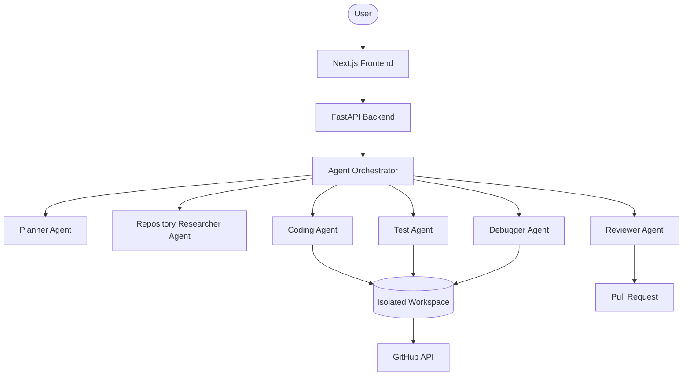

# NEXUS Architecture

NEXUS uses a modern modular architecture for AI-powered software engineering. 

## High Level Overview

## Components

- **Frontend:** Next.js application that provides the user interface for tracking execution progress, viewing diffs, and approving PRs.
- **Backend:** FastAPI application acting as the control plane.
- **Orchestrator:** Manages the sequential and conditional execution of various specialized agents.
- **Agents:** Small, task-specific modules utilizing Google Gemini and ADK.
- **Workspace:** A temporary, isolated sandbox where code changes are made and tests are run.
